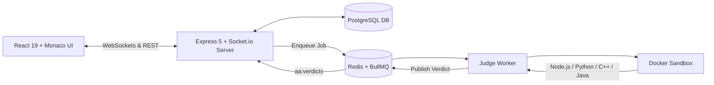

<div align="center">

# ⚔️ AlgoArena

### **Real-Time 1v1 Competitive Coding & Multiplayer DSA Duels**

*Chess.com meets LeetCode — Battle developers head-to-head on algorithmic challenges in real-time.*

<br/>

[](https://react.dev/)
[](https://nodejs.org/)
[](https://supabase.com/)
[](https://redis.io/)
[](https://www.docker.com/)
[](https://socket.io/)

<br/>

[Key Features](#-features) • [System Architecture](#-architecture) • [Tech Stack](#-tech-stack) • [Quick Start](#-quick-start) • [Supported Languages](#-supported-languages)

---

</div>

## 💡 What is AlgoArena?

Practicing DSA alone on LeetCode can feel slow and unengaging. **AlgoArena** turns algorithmic problem-solving into a fast-paced multiplayer competitive esport.

Match with opponents based on your **Elo rating**, receive the same problem simultaneously, write code in **Monaco Editor**, watch your opponent's live progress telemetry, and race to pass all secret test cases. Submissions are judged in isolated **Docker containers** with instant verdict streaming over WebSockets.

---

## ⚡ Features

<table>
  <tr>
    <td width="50%">
      <h3>⚔️ Real-Time 1v1 Battles</h3>
      <p>Instant skill-based matchmaking with expanding search bands. Experience live opponent telemetry, typing indicators, line-count tracking, and instant win/loss triggers.</p>
    </td>
    <td width="50%">
      <h3>🔒 Sandboxed Code Execution</h3>
      <p>Submissions run inside isolated, non-root Docker containers with strict RAM (256MB), CPU, PID, and <code>--network none</code> security constraints.</p>
    </td>
  </tr>
  <tr>
    <td width="50%">
      <h3>📊 Elo Rating & Dynamic Tiers</h3>
      <p>Chess-style rating system featuring dynamic K-factors, solve-speed bonuses, problem difficulty multipliers, placement calibration, and global leaderboards.</p>
    </td>
    <td width="50%">
      <h3>👥 Custom Match Rooms</h3>
      <p>Generate 6-character room codes or direct challenge links to battle friends, host study groups, or run mock interview sprints unrated.</p>
    </td>
  </tr>
  <tr>
    <td width="50%">
      <h3>💻 Monaco Editor & Smart Harnesses</h3>
      <p>VS Code-powered editor with syntax highlighting, custom themes, and automatic <code>TreeNode</code> & <code>ListNode</code> deserialization for complex structures.</p>
    </td>
    <td width="50%">
      <h3>📈 Detailed Analytics & Profile</h3>
      <p>Track your Elo progression charts, match history, win rates across problem topics, daily duel streaks, and customizable avatar styles.</p>
    </td>
  </tr>
</table>

---

## 🏛️ Architecture



1. **Client Layer**: React 19 single-page app with Monaco Editor and persistent Socket.io connection.
2. **Gateway Layer**: Express 5 REST API + Socket.io gateway managing authentication, room states, and matchmaking queues.
3. **Queue & Broker**: Redis and BullMQ distributed queues decoupling heavy code execution from API traffic.
4. **Execution Sandbox**: Dedicated worker pool executing untrusted user code inside hardened, zero-network Docker containers.

---

## 🛠️ Tech Stack

| Domain | Technologies |
| :--- | :--- |
| **Frontend** | **React 19**, **Vite**, **Monaco Editor** (`@monaco-editor/react`), **Tailwind CSS**, **Socket.io Client**, **Axios**, **React Router 7** |
| **Backend & Realtime** | **Node.js**, **Express 5**, **Socket.io 4**, **PostgreSQL** (`pg` pool, `pgcrypto`), **JWT**, **Bcrypt**, **Nodemailer** |
| **Queue & Messaging** | **Redis** (Upstash), **BullMQ 5** (Distributed job queue & pub/sub) |
| **Judge & Sandbox** | **Docker Engine**, **Alpine Linux** (`node:20-alpine`), **GCC / G++ 13**, **Python 3.11**, **OpenJDK 17** |
| **Authentication** | **JWT (HS256)**, **Email OTP** (Nodemailer SMTP), **Google OAuth** (Firebase Admin) |

---

## 💻 Supported Languages

AlgoArena supports multi-language execution with native data-structure builders:

| Language | Runtime / Compiler | Version | Features |
| :--- | :--- | :--- | :--- |
| **JavaScript** | Node.js VM & Container | `v20.x` | Built-in Tree & Linked-List parser |
| **Python** | Python 3 | `3.11+` | Automatic AST parameter unpacking |
| **C++** | GCC (G++) | `C++17` | High-speed execution with `nlohmann-json` |
| **Java** | OpenJDK | `Java 17` | Auto-compiled with memory-tuned flags |

---

## 🏆 Problem Categories

Over **175+ curated algorithmic problems** across key competitive programming topics:

`Arrays` • `Strings` • `Linked Lists` • `Trees & BST` • `Dynamic Programming` • `Graphs & BFS/DFS` • `Binary Search` • `Sorting`

---

## 🚀 Quick Start

### 1. Clone & Install Dependencies
```bash
git clone https://github.com/ayushoncode/AlgoArena.git
cd algoarena

# Install dependencies for all services
cd backend && npm install
cd ../frontend && npm install
cd ../workers && npm install
cd ..
```

### 2. Configure Environment Variables
Create `.env` files in `backend/`, `workers/`, and `frontend/`:

**`backend/.env`**
```env
PORT=4000
NODE_ENV=development
CLIENT_URL=http://localhost:5173
DATABASE_URL=your_postgresql_connection_string
REDIS_URL=your_redis_connection_string
JWT_SECRET=your_super_secret_jwt_key
```

**`workers/.env`**
```env
DATABASE_URL=your_postgresql_connection_string
REDIS_URL=your_redis_connection_string
SANDBOX_IMAGE=algoarena-sandbox
WORKER_CONCURRENCY=3
```

**`frontend/.env`**
```env
VITE_API_URL=http://localhost:4000
```

### 3. Build Sandbox & Run Services

```bash
# Build the Docker sandbox image (one-time setup)
docker build -t algoarena-sandbox -f workers/Dockerfile.sandbox workers/
```

Start the services across three terminals:

```bash
# Terminal 1: Backend API & WebSocket Gateway
cd backend && npm start

# Terminal 2: Background Submission Worker
cd workers && npm start

# Terminal 3: Frontend Web App
cd frontend && npm run dev
```

Open **`http://localhost:5173`** to enter the arena! ⚔️

---

## 🗺️ Roadmap

- [x] Real-time 1v1 matchmaking with dynamic Elo scaling
- [x] Multi-language Docker sandbox judge (JS, Python, C++, Java)
- [x] Custom private battle rooms with shareable codes
- [x] Global leaderboards & detailed rating progression analytics
- [ ] **Tournament Bracket Mode** — Auto-generated knockout brackets for communities
- [ ] **2v2 Team Battles** — Co-op competitive problem-solving
- [ ] **Spectator Mode** — Watch ongoing ranked matches live with dual code view

---

## 📄 License & Author

Distributed under the **ISC License**.


<div align="center">
  <sub>⭐ Star this repository if you find it helpful!</sub>
</div>
